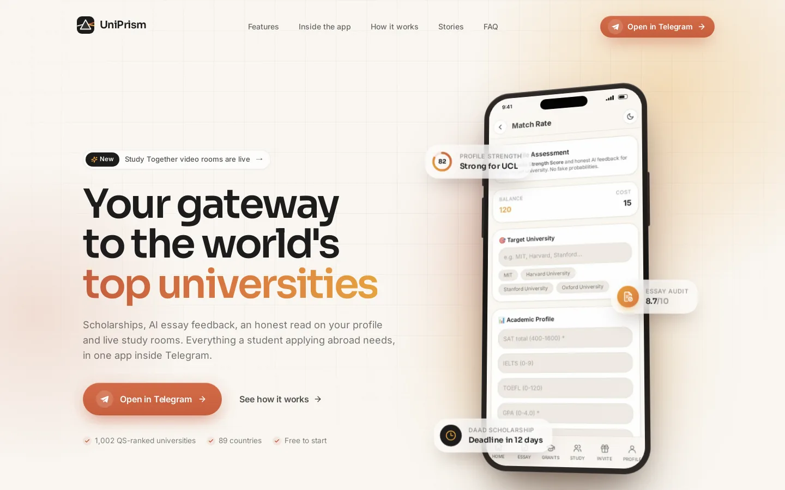

# UniPrism Landing Page

The marketing site for **[UniPrism](https://uniprism.site)**, an admissions companion for students applying to universities abroad. It runs inside Telegram as a Mini App.

**Live:** [uniprism.site](https://uniprism.site) · **App:** [@UniPrismBot](https://t.me/UniPrismBot)



## Highlights

- **3D hero device:** a phone mockup that tilts toward the pointer, cycles through real app screens and has floating glass cards.
- **Bento feature grid:** eight cards with hand-built duotone SVG icons, a cursor-following spotlight and small animated illustrations.
- **Interactive showcase:** tabs that auto-advance and switch the phone screen.
- **Scroll-driven motion:** staggered reveals, connector lines that draw themselves, and stats that count up when they come into view.
- **Accessible:** semantic landmarks, a skip link, ARIA tabs and accordion, keyboard support and `prefers-reduced-motion` handling.
- **Responsive:** tested from 320 px to 1920 px with no horizontal scrolling.
- **Fast:** the hero ships first and everything below the fold loads as a separate chunk. Framer Motion is loaded through `LazyMotion`, images are WebP with responsive `srcset`, and the hero image is preloaded.
- **SEO ready:** meta description, canonical URL, Open Graph and Twitter cards, JSON-LD, sitemap and robots.txt.

## Tech stack

| | |
|---|---|
| Framework | [React 19](https://react.dev) + TypeScript |
| Build | [Vite 6](https://vite.dev) |
| Styling | [Tailwind CSS 3](https://tailwindcss.com) |
| Animation | [Framer Motion 11](https://motion.dev) |
| Icons | Custom SVG set + [Lucide](https://lucide.dev) for UI glyphs |
| Fonts | [Sora](https://fonts.google.com/specimen/Sora) (display) and [Inter](https://rsms.me/inter/) (text) |

## Getting started

Requires Node.js 20 or later.

```bash
npm install
npm run dev        # http://localhost:5173
```

| Script | Description |
|---|---|
| `npm run dev` | Start the dev server with hot reload |
| `npm run build` | Type-check and build to `dist/` |
| `npm run preview` | Serve the production build locally |
| `npm run typecheck` | Run the TypeScript compiler only |

## Project structure

```
.
├── index.html              # HTML shell, SEO meta, fonts, LCP preload
├── public/                 # Favicons, OG image, robots, sitemap, app screenshots
└── src/
    ├── main.tsx            # Entry point
    ├── Landing.tsx         # Page shell: navbar, hero, lazy sections
    ├── BelowTheFold.tsx    # Sections loaded as a separate chunk
    ├── content.ts          # All copy, links and numbers
    ├── landing.css         # Tailwind layers and custom effects
    └── components/
        ├── Navbar.tsx      # Floating glass navigation and mobile menu
        ├── Hero.tsx        # Headline, CTA and 3D phone
        ├── Phone.tsx       # Device frame with cross-fading screens
        ├── Marquee.tsx     # University name band
        ├── Features.tsx    # Bento grid
        ├── Showcase.tsx    # "Inside the app" tabs
        ├── HowItWorks.tsx  # Steps with animated connectors
        ├── Stats.tsx       # Count-up numbers
        ├── Testimonials.tsx
        ├── Faq.tsx         # Animated accordion
        ├── Footer.tsx      # Closing CTA and footer
        ├── icons.tsx       # Custom duotone and brand icons
        ├── primitives.tsx  # Container, headings, buttons
        └── motion.ts       # Shared animation presets
```

## Editing content

All text, links, features, stats, testimonials and FAQ entries live in [`src/content.ts`](src/content.ts), so copy changes never touch the components.

> **Testimonials:** the current quotes are illustrative placeholders, and the page labels them that way. Replace them with real, consented quotes and set `TESTIMONIALS_ILLUSTRATIVE` to `false`.

## Deployment

The build output in `dist/` is a fully static site that can be hosted anywhere (Nginx, Netlify, Vercel, Cloudflare Pages, GitHub Pages).

To build and serve it with Docker and Nginx:

```bash
docker build -t uniprism-landing .
docker run -p 8080:80 uniprism-landing    # http://localhost:8080
```

`nginx.conf` enables gzip and caches the hashed files in `/assets/` for one year.

`index.html` includes a small inline script that forwards Telegram Mini App launches (URLs carrying `#tgWebAppData`) to the app at `/app/`. On uniprism.site the app is served from `/app/`. Normal visits are never redirected.

## License

[MIT](LICENSE) © 2026 Shamshodbek Maxammadjonov
